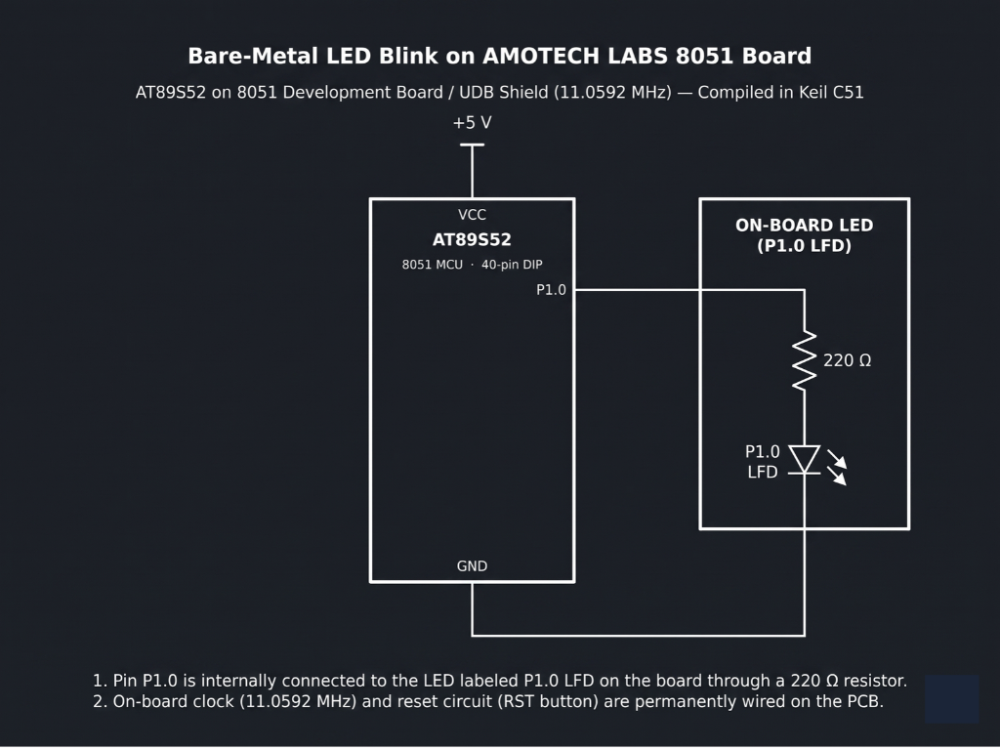

# Continuous Lab Evaluation-2 (Task 2B)

**EXP:** Continuous Lab Evaluation-2  
**DATE:** 14/08/2026  
**NAME OF EXP:** Simple LED Blinking Using Software Delay on 8051 Microcontroller  
**HARDWARE SETUP / PLATFORM:** Keil uVision + AT89S52 Microcontroller + LED on Port 1 Pin 0 (P1.0) + In-System Programmer  

---

### Circuit Diagram


---

### Core Logic

* **1. GPIO Port Initialization and SBIT Definition**  
  Port 1 Pin 0 is declared as a single-bit output using `sbit LED = P1^0;`. All pins of Port 1 are initialized to `0x00` during setup to ensure a defined initial state.

* **2. Software Delay Generation**  
  A double-nested `for` loop provides the software delay between state transitions without using hardware timers:
  ```c
  void delay(void) {
      unsigned int i, j;
      for (i = 0; i < 500; i++) {
          for (j = 0; j < 500; j++) {
          }
      }
  }
  ```

* **3. Main Execution Loop**  
  The main loop alternates the logic level on `P1^0` between HIGH (`1`) and LOW (`0`) with intervening delay cycles, generating a continuous square-wave blinking pattern:
  ```c
  while (1) {
      LED = 1;      // Turn LED ON 
      delay();
      LED = 0;      // Turn LED OFF 
      delay();
  }
  ```

---

### Inference
Basic digital output control on the 8051 architecture was verified. Direct port pin manipulation using `sbit` was implemented alongside software nested delay loops to achieve periodic visual LED blinking.
