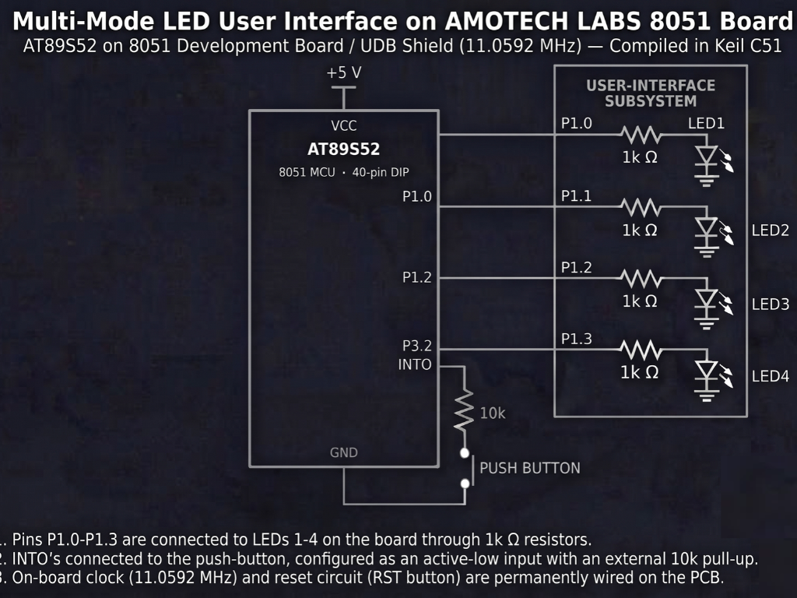

# Continuous Lab Evaluation-3 (Task 3A)

**EXP:** Continuous Lab Evaluation-3  
**DATE:** 21/08/2026  
**NAME OF EXP:** External Interrupt (INT0) Driven Push Button with Debounce and Multi-Pattern LED Sequencer  
**HARDWARE SETUP / PLATFORM:** Keil uVision + AT89S52 Microcontroller + Push Button on INT0 (P3.2) + 4 LEDs on Port 1 (P1.0 - P1.3)  

---

### Circuit Diagram


---

### Core Logic

* **1. Timer 0 1ms Millisecond Ticks Counter**  
  Timer 0 is configured in Mode 1 (16-bit) to generate periodic 1 ms interrupts (`TH0 = 0xFC; TL0 = 0x66;`), driving non-blocking time-tracking variable `ms_ticks`:
  ```c
  void Timer0_ISR(void) interrupt 1 {
      TH0 = 0xFC;
      TL0 = 0x66;
      ms_ticks++;
  }
  ```

* **2. External Interrupt INT0 Button Handling & Debounce**  
  Falling-edge triggered external interrupt `INT0` sets `pendingPress = 1;` when button connected to `P3.2` is actuated. Software state machine confirms 20 ms steady hold before incrementing `mode` to eliminate mechanical contact bounce.

* **3. Multi-Pattern LED Mode Sequencer**  
  Four distinct display routines are executed on Port 1 pins:
  - **Mode 1 (Running LED):** Sequential shifting of a single lit LED across pins `P1.0` through `P1.3`.
  - **Mode 2 (Binary Counter):** 4-bit incrementing counter displayed across LEDs.
  - **Mode 3 (Alternating Pattern):** Alternating flashing between even and odd bit positions.
  - **Mode 4 (All Flash):** Simultaneous blinking of all 4 LEDs.

---

### Inference
Interrupt-driven event detection using hardware `INT0` combined with timer-based software debouncing was successfully implemented. The application demonstrates responsive mode switching without stalling CPU cycles in busy-wait polling loops.
