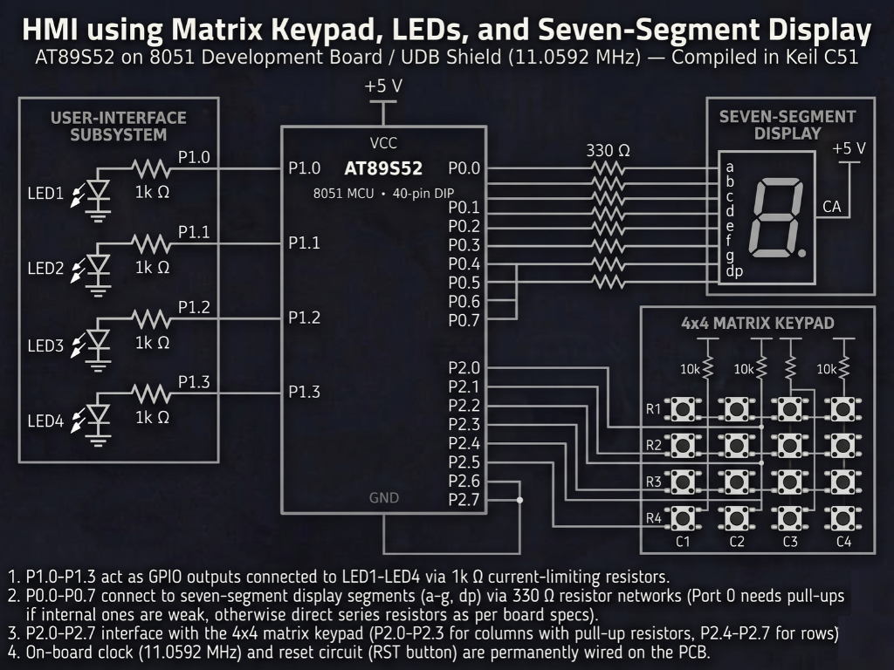

# Continuous Lab Evaluation-4 (Task 4A)

**EXP:** Continuous Lab Evaluation-4  
**DATE:** 28/08/2026  
**NAME OF EXP:** 4x4 Matrix Keypad Interfacing and Display Mode Decoding on 8051  
**HARDWARE SETUP / PLATFORM:** Keil uVision + AT89S52 Microcontroller + 4x4 Matrix Keypad (Port 2) + LEDs on Port 1 (P1.1 - P1.4)  

---

### Circuit Diagram


---

### Core Logic

* **1. Column & Row Matrix Scanning Algorithm**  
  Port 2 pins `P2.4 - P2.7` are used for column lines. Matrix rows are driven LOW sequentially while column input lines are sampled with pull-up verification:
  ```c
  void keypad_scan() {
      // Pull row LOW and test columns COL1 to COL4
      P2 = 0x0F;
      // Identify active coordinate and return key code
  }
  ```

* **2. Key Value Decoding & Function Dispatch**  
  Detected key presses are decoded to select one of multiple execution modes:
  - Single LED direct illumination (`led_control(key)`)
  - Running LED pattern sequence (`running_led()`)
  - Binary count progression (`binary_counter()`)
  - Alternating LED strobe (`alternate_led()`)
  - All-LED synchronized flash (`blink_all()`)

---

### Inference
Matrix scanning multiplexing was validated for input acquisition. By driving row lines LOW and sampling columns, the microcontroller maps multiple push buttons using minimal I/O pins, subsequently driving multi-mode visual feedback on Port 1.
