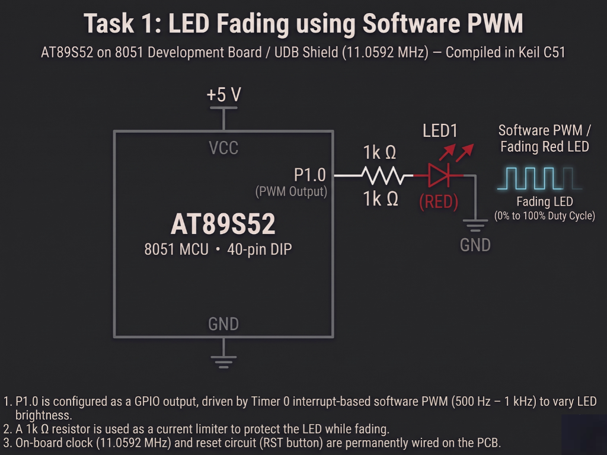

# Continuous Lab Evaluation-5 (Task 5A)

**EXP:** Continuous Lab Evaluation-5  
**DATE:** 04/09/2026  
**NAME OF EXP:** 8051 Hardware Timer 0 in Mode 1 (16-bit) for 1-Second Periodic Delay  
**HARDWARE SETUP / PLATFORM:** Keil uVision + AT89S52 Microcontroller + LED on Port 1 Pin 0 (P1.0)  

---

### Circuit Diagram


---

### Core Logic

* **1. Timer 0 Mode 1 Configuration (16-bit Timer)**  
  `TMOD` is configured to `0x01` (Timer 0 in 16-bit mode). Reload values `TH0 = 0xFC` and `TL0 = 0x66` produce a 1 ms interrupt period with an 11.0592 MHz / 12 MHz crystal:
  ```c
  void Timer0_ISR(void) interrupt 1 {
      TH0 = 0xFC;
      TL0 = 0x66;
      count++;
      if(count >= 1000) {
          LED = ~LED;
          count = 0;
      }
  }
  ```

* **2. Precise 1-Second Timebase Generation**  
  Accumulating 1000 timer interrupts produces an accurate 1.0-second delay interval, toggling `P1^0` with hardware precision rather than CPU-dependent software delay loops.

---

### Inference
Hardware timer-based delay generation was implemented. Utilizing Timer 0 in 16-bit Mode 1 offloads time-critical execution from the main loop, providing accurate 1 Hz output toggling.
