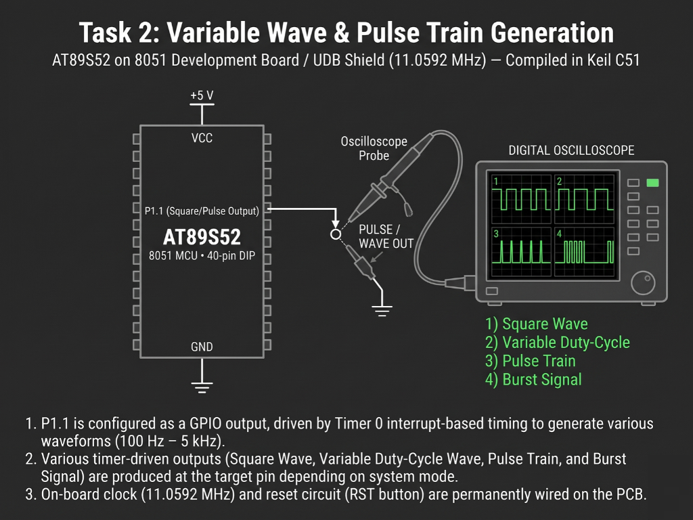

# Continuous Lab Evaluation-5 (Task 5B.4)

**EXP:** Continuous Lab Evaluation-5  
**DATE:** 04/09/2026  
**NAME OF EXP:** Pulse Train Generation with Asymmetric Mark-Space Ratio on 8051  
**HARDWARE SETUP / PLATFORM:** Keil uVision + AT89S52 Microcontroller + Output Pin on Port 1 Pin 1 (P1.1)  

---

### Circuit Diagram


---

### Core Logic

* **1. Timer 1 Periodic Interrupt**  
  Timer 1 operates in Mode 1, triggering interrupts every 1 ms with `TH1 = 0xFC; TL1 = 0x66;`.

* **2. 1-to-7 Duty Cycle Ratio Generator**  
  The output waveform is driven HIGH for 1 interval (`count == 0`) and driven LOW for the subsequent 7 intervals (`count >= 1`), producing a 1:7 pulse train:
  ```c
  void timer1_ISR(void) interrupt 3 {
      TH1 = 0xFC;
      TL1 = 0x66;

      if(count == 0)
          OUTPUT = 1;
      else
          OUTPUT = 0;

      count++;
      if(count >= 8)
          count = 0;
  }
  ```

---

### Inference
A discrete pulse train with a 1:7 duty ratio was generated using Timer 1. This technique is widely applicable in strobe triggers, sampling clocks, and pulse-position modulation.
