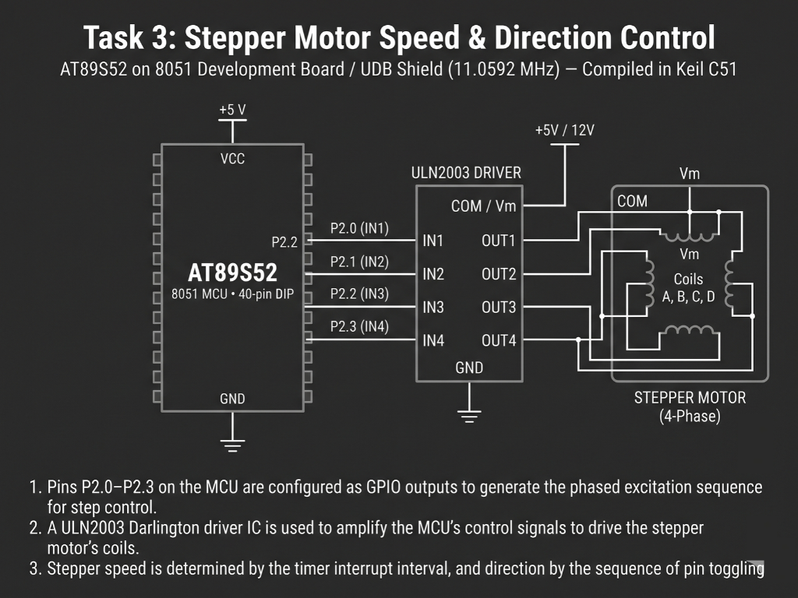

# Continuous Lab Evaluation-5 (Task 5C)

**EXP:** Continuous Lab Evaluation-5  
**DATE:** 04/09/2026  
**NAME OF EXP:** Stepper Motor Speed Control via 4x4 Keypad and Timer Interrupts on 8051  
**HARDWARE SETUP / PLATFORM:** Keil uVision + AT89S52 Microcontroller + 4x4 Keypad + ULN2003 Driver + 4-phase Unipolar Stepper Motor on Port 2  

---

### Circuit Diagram


---

### Core Logic

* **1. Keypad Scanning for Motor Speed Selection**  
  Matrix keypad scanning decodes numeric inputs 1, 2, 3 to dynamically set the step rate `step_interval`.

* **2. 4-Phase Stepper Coil Commutation Sequence**  
  The step sequence rotates through 4 discrete phase configurations on Port 2:
  ```c
  void step_motor(void) {
      coil = (coil << 1) | (coil >> 3); // Rotate bit pattern
      P2 = (P2 & 0xF0) | (coil & 0x0F);
  }
  ```

* **3. Timer 0 Interrupt-Driven Stepping**  
  Every timer tick compares `timer_count` with `step_interval` to advance the motor, ensuring smooth, jitter-free rotation at user-selected speeds.

---

### Inference
Closed-loop human-machine interface for actuator speed control was implemented. Keypad inputs dynamically adjust the step commutation period, demonstrating responsive motor control on the 8051.
