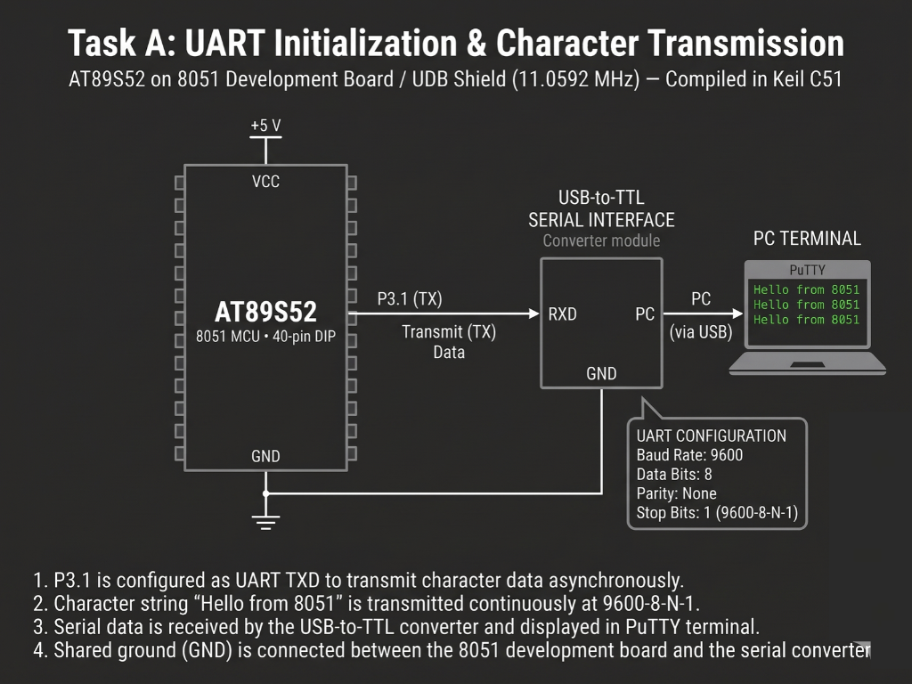

# Continuous Lab Evaluation-6 (Task 6A)

**EXP:** Continuous Lab Evaluation-6  
**DATE:** 18/09/2026  
**NAME OF EXP:** UART Serial String Transmission at 9600 Baud Using Timer 1 Mode 2 Auto-Reload  
**HARDWARE SETUP / PLATFORM:** Keil uVision + AT89S52 Microcontroller + MAX232 / USB-to-UART Adapter + PC Serial Terminal  

---

### Circuit Diagram


---

### Core Logic

* **1. UART Configuration & Baud Rate Generation**  
  `SCON = 0x50` configures 8-bit UART with reception enabled. Timer 1 in Mode 2 (8-bit auto-reload) with `TH1 = 0xFD` generates standard 9600 baud at 11.0592 MHz:
  ```c
  SCON = 0x50;  // Mode 1: 8-bit UART, REN enabled
  TMOD |= 0x20; // Timer 1 Mode 2 auto-reload
  TH1 = 0xFD;   // 9600 baud rate
  TR1 = 1;      // Start timer
  ES = 1;       // Enable serial interrupt
  EA = 1;       // Enable global interrupts
  ```

* **2. Serial Interrupt-Driven Character Transmission**  
  When character transmission completes, hardware asserts the `TI` flag, triggering interrupt 4 to automatically load the next string character into `SBUF`:
  ```c
  void serial_interrupt(void) interrupt 4 {
      if(TI) {
          TI = 0;
          if(index == 7) index = 0;
          SBUF = message[index++];
      }
  }
  ```

---

### Inference
Asynchronous serial communication was verified. Interrupt-driven transmission maximizes CPU availability by loading subsequent bytes into `SBUF` only upon completion of preceding transmissions.
