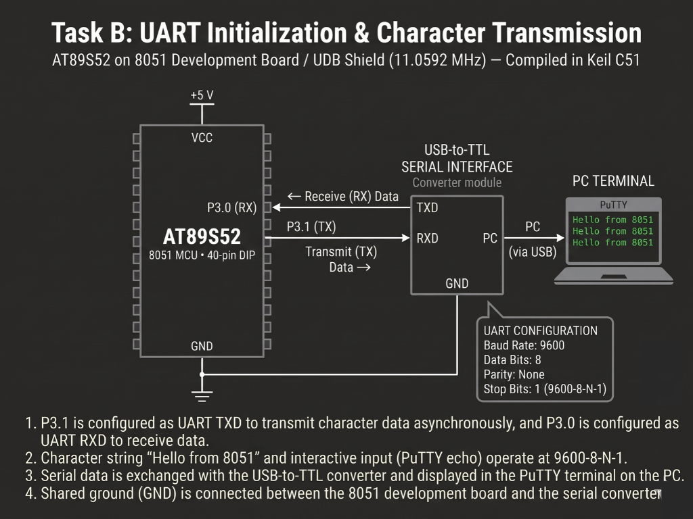

# Continuous Lab Evaluation-6 (Task 6B)

**EXP:** Continuous Lab Evaluation-6  
**DATE:** 18/09/2026  
**NAME OF EXP:** Bidirectional UART Serial Communication & Character Echo Receiver on 8051  
**HARDWARE SETUP / PLATFORM:** Keil uVision + AT89S52 Microcontroller + USB-to-TTL Serial Bridge + PuTTY / TeraTerm Terminal  

---

### Circuit Diagram


---

### Core Logic

* **1. Receive Interrupt Handling (RI Flag)**  
  Incoming serial bytes assert `RI`. The ISR reads `SBUF` and echoes the character directly back to the terminal:
  ```c
  void serial_interrupt(void) interrupt 4 {
      if(RI) {
          RI = 0;
          c = SBUF;
          SBUF = c; // Echo character back
      }
      if(TI) {
          TI = 0;
      }
  }
  ```

---

### Inference
Full-duplex serial communication and echo functionality were verified. Characters received from a PC host terminal are immediately echoed back, confirming proper baud synchronization and framing.
