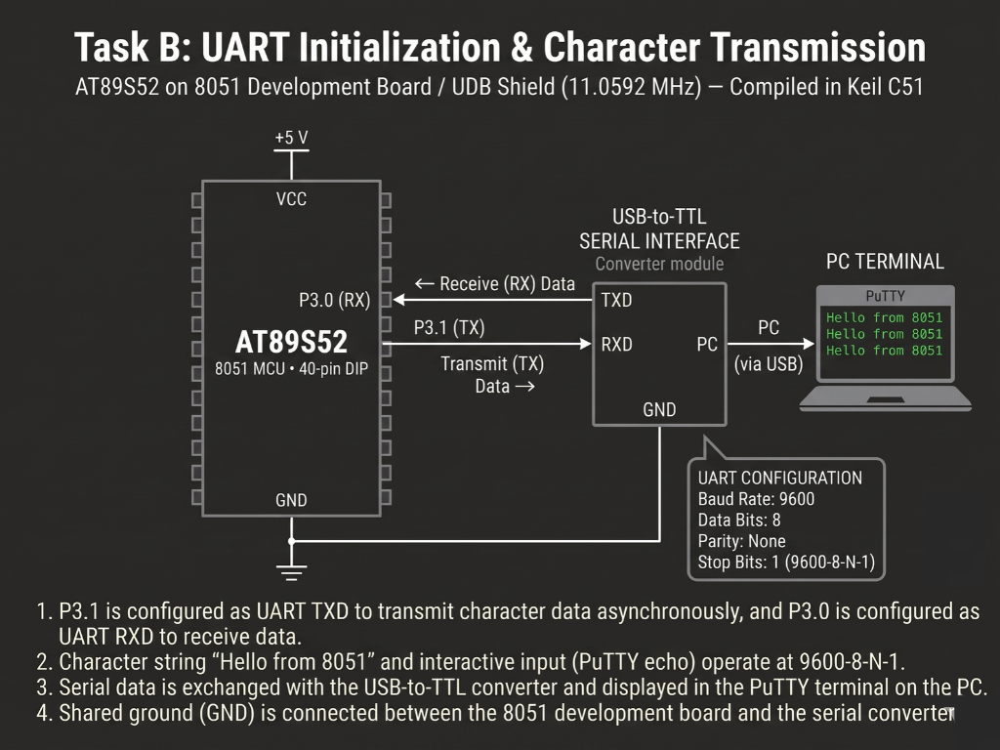

# Continuous Lab Evaluation-7 (Task 7A)

**EXP:** Continuous Lab Evaluation-7  
**DATE:** 25/09/2026  
**NAME OF EXP:** 16x2 Alphanumeric LCD Interfacing in 4-bit Mode on 8051  
**HARDWARE SETUP / PLATFORM:** Keil uVision + AT89S52 Microcontroller + HD44780-compatible 16x2 LCD on Port 2 (RS=P2.0, EN=P2.1)  

---

### Circuit Diagram


---

### Core Logic

* **1. 4-bit Nibble Transmission Protocol**  
  Commands and character data are partitioned into high and low nibbles sent sequentially over `P2.4 - P2.7`:
  ```c
  void lcd_nibble(unsigned char value) {
      LCD_PORT = (LCD_PORT & 0x0F) | (value & 0xF0);
      EN = 1;
      delay(1);
      EN = 0;
  }
  ```

* **2. LCD Initialization Sequence**  
  Sends `0x02` (return home), `0x28` (4-bit mode, 2-line display), `0x0C` (display ON, cursor OFF), and `0x01` (clear display).

* **3. Text & String Rendering**  
  `lcd_goto(row, col)` positions the DDRAM pointer, and `lcd_puts(str)` streams character bytes to display alphanumeric text.

---

### Inference
4-bit LCD interfacing reduces microcontroller pin consumption from 8 to 4 data lines. The HD44780 command sequence was successfully verified for static string display.
