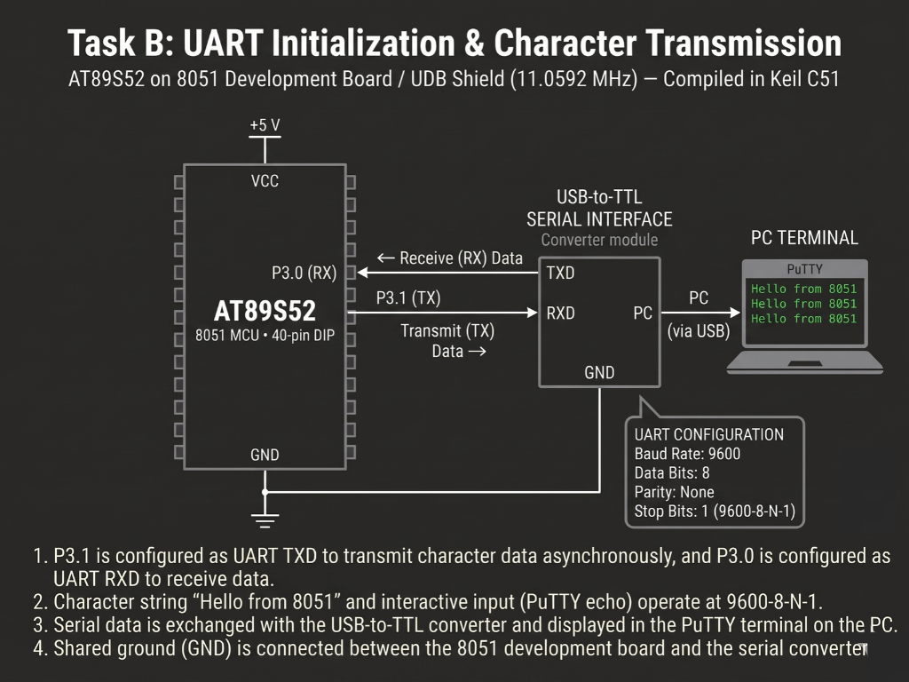

# Continuous Lab Evaluation-7 (Task 7B)

**EXP:** Continuous Lab Evaluation-7  
**DATE:** 25/09/2026  
**NAME OF EXP:** 16x2 LCD Dynamic Integer Counter and Position Updating on 8051  
**HARDWARE SETUP / PLATFORM:** Keil uVision + AT89S52 Microcontroller + 16x2 LCD on Port 2 (RS=P2.0, EN=P2.1)  

---

### Circuit Diagram

---

### Core Logic

* **1. Number-to-String ASCII Conversion**  
  `lcd_print_number(num)` formats multi-digit integers into ASCII character bytes for display on the LCD.

* **2. Dynamic In-Place Refresh**  
  In the main loop, `lcd_goto()` relocates the cursor to the exact counter coordinates, clears preceding digits, and writes updated values without refreshing the entire screen.

---

### Inference
Real-time dynamic display updating was demonstrated. Targeted cursor relocation avoids screen flicker, providing smooth numerical updates on the alphanumeric LCD.
