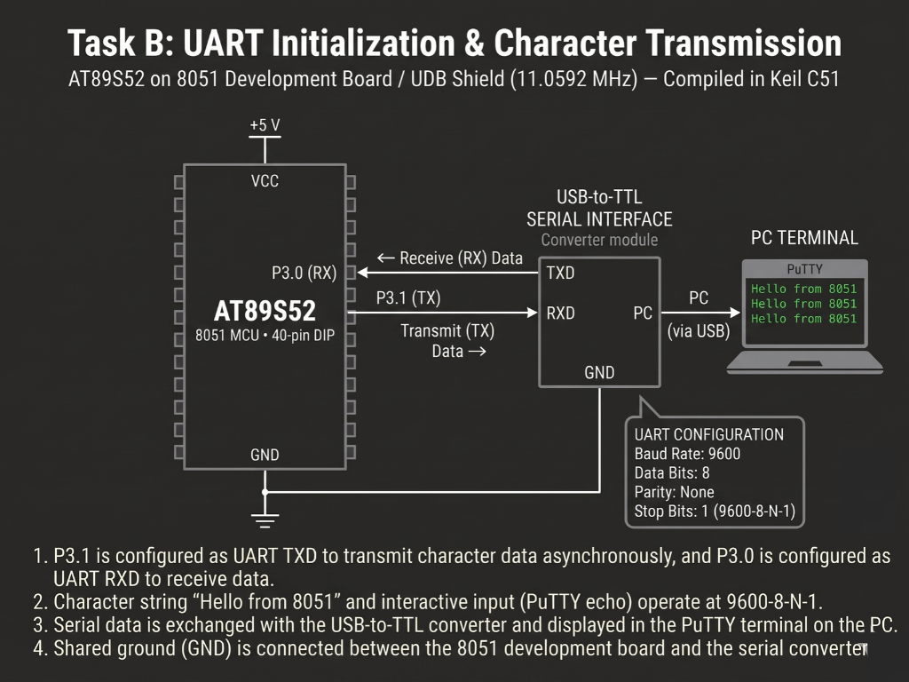

# Continuous Lab Evaluation-7 (Task 7C)

**EXP:** Continuous Lab Evaluation-7  
**DATE:** 25/09/2026  
**NAME OF EXP:** Interactive Keypad-Driven 16x2 LCD Cursor and Character Navigation on 8051  
**HARDWARE SETUP / PLATFORM:** Keil uVision + AT89S52 Microcontroller + 16x2 LCD (Port 2) + 4x4 Matrix Keypad (Port 1)  

---

### Circuit Diagram


---

### Core Logic

* **1. Keypad Scanning on Port 1**  
  Rows (`P1.0 - P1.3`) and Columns (`P1.4 - P1.7`) are scanned to register navigation inputs (Up, Down, Left, Right).

* **2. Interactive Character Movement Engine**  
  Previous character positions are cleared with a blank space `' '`, coordinates are updated based on key inputs, and the character is rendered at the new position:
  ```c
  lcd_goto(cur_row, cur_col);
  lcd_data(' '); // Erase old character
  // Update coordinates according to key pressed
  lcd_goto(new_row, new_col);
  lcd_data('*'); // Render character at new position
  ```

---

### Inference
An interactive human-machine interface combining matrix keypad inputs and alphanumeric LCD output was validated, demonstrating coordinate management and character manipulation.
