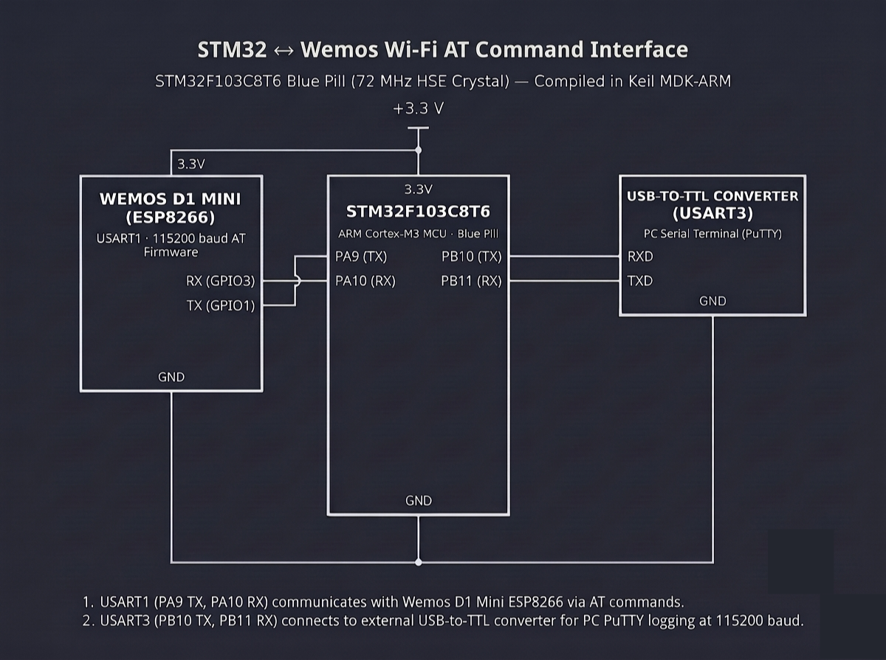

# Continuous Lab Evaluation-11 (Task 11A)

**EXP:** Continuous Lab Evaluation-11  
**DATE:** 30/10/2026  
**NAME OF EXP:** Embedded HTTP Web Server on STM32 and ESP8266 (Static HTML Delivery)  
**HARDWARE SETUP / PLATFORM:** STM32CubeMX + Keil MDK-ARM + STM32F103C8T6 + ESP8266 Wi-Fi Module + Local Web Browser  

---

### Circuit Diagram


---

### Core Logic

* **1. TCP Server Initialization on Port 80**  
  Enables multi-connection socket listening (`AT+CIPMUX=1`) and creates an HTTP server on port 80 (`AT+CIPSERVER=1,80`):
  ```c
  send_cmds("AT+CIPMUX=1\r\n", 1000);
  send_cmds("AT+CIPSERVER=1,80\r\n", 3000);
  ```

* **2. HTTP Request Interception & Static Page Delivery**  
  Monitors incoming data streams containing `+IPD` and dispatches standard HTTP 200 OK headers accompanied by HTML content back to the requesting client browser.

---

### Inference
An embedded web server was implemented directly on the STM32 via ESP8266 AT commands, allowing browser clients to connect and view static system status pages.
