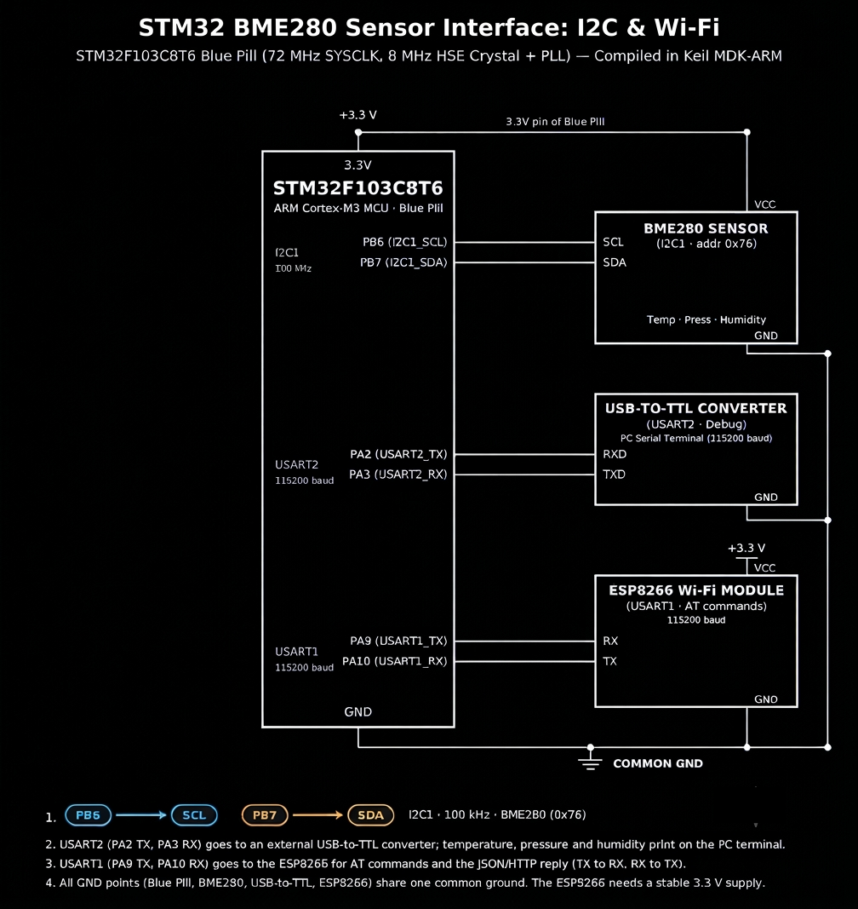

# Continuous Lab Evaluation-13 (Task 13)

**EXP:** Continuous Lab Evaluation-13  
**DATE:** 13/11/2026  
**NAME OF EXP:** Bosch BME280 Environmental Sensor Interfacing over I2C on STM32  
**HARDWARE SETUP / PLATFORM:** STM32CubeMX + Keil MDK-ARM + STM32F103C8T6 + Bosch BME280 Sensor (I2C1 PB6 SCL, PB7 SDA) + Serial Terminal  

---

### Circuit Diagram


---

### Core Logic

* **1. BME280 Sensor Initialization & Calibration**  
  Initializes communication with BME280 at I2C address `0x76`, reading factory calibration compensation registers:
  ```c
  static uint8_t dev_addr = BME280_I2C_ADDR_PRIM; // 0x76
  dev.intf_ptr = &dev_addr;
  dev.intf = BME280_I2C_INTF;
  dev.read = user_i2c_read;
  dev.write = user_i2c_write;
  dev.delay_us = user_delay_us;
  rslt = bme280_init(&dev);
  ```

* **2. Continuous Data Acquisition & Compensation**  
  Oversampling is configured for Temperature, Humidity, and Pressure. The compensated sensor data is polled and formatted for transmission over USART:
  ```c
  rslt = bme280_get_sensor_data(BME280_ALL, &comp_data, &dev);
  if (rslt == BME280_OK) {
      // Temperature in °C, Humidity in %RH, Pressure in hPa
  }
  ```

---

### Inference
Hardware I2C communication and multi-parameter sensor calibration were validated. The STM32 accurately extracts temperature, humidity, and barometric pressure data from the digital BME280 sensor.
