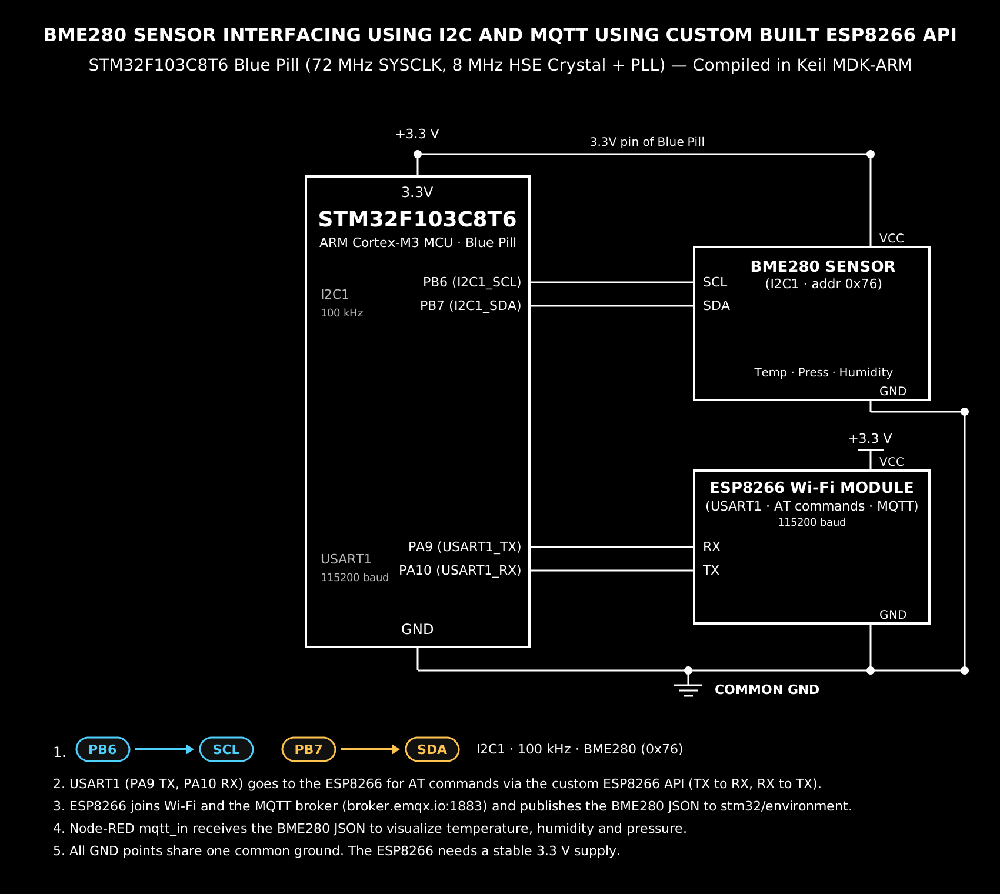

# Continuous Lab Evaluation-14 (Task 14)

**EXP:** Continuous Lab Evaluation-14  
**DATE:** 20/11/2026  
**NAME OF EXP:** MQTT Telemetry Publisher and Remote Control Subscriber on STM32 via Wi-Fi  
**HARDWARE SETUP / PLATFORM:** STM32CubeMX + Keil MDK-ARM + STM32F103C8T6 + BME280 Sensor + ESP8266 (Wi-Fi) + MQTT Broker (broker.emqx.io)  

---

### Circuit Diagram


---

### Core Logic

* **1. MQTT Protocol Connection Handshake**  
  Establishes TCP connection to `broker.emqx.io` on port 1883 and issues MQTT CONNECT packet:
  ```c
  ESP8266_portConnect("TCP", (char*)MQTT_BROKER, (char*)MQTT_PORT);
  MQTT_InitTypeDef_t mqttInitConfig;
  mqttInitConfig.clientID    = "STM32_BME280_Node_SNUC_01";
  mqttInitConfig.keepAlive   = 500;
  mqttInitConfig.connectFlag = CleanSession;
  MQTT_connectBroker(&mqttInitConfig);
  ```

* **2. Topic Subscription & Telemetry Publishing**  
  Subscribes to incoming command topic `stm32/control` and publishes JSON-formatted environmental telemetry payloads to `stm32/environment`.

---

### Inference
Lightweight MQTT messaging was implemented on the STM32 via an ESP8266 Wi-Fi bridge. The node successfully publishes live telemetry and receives asynchronous actuation commands.
