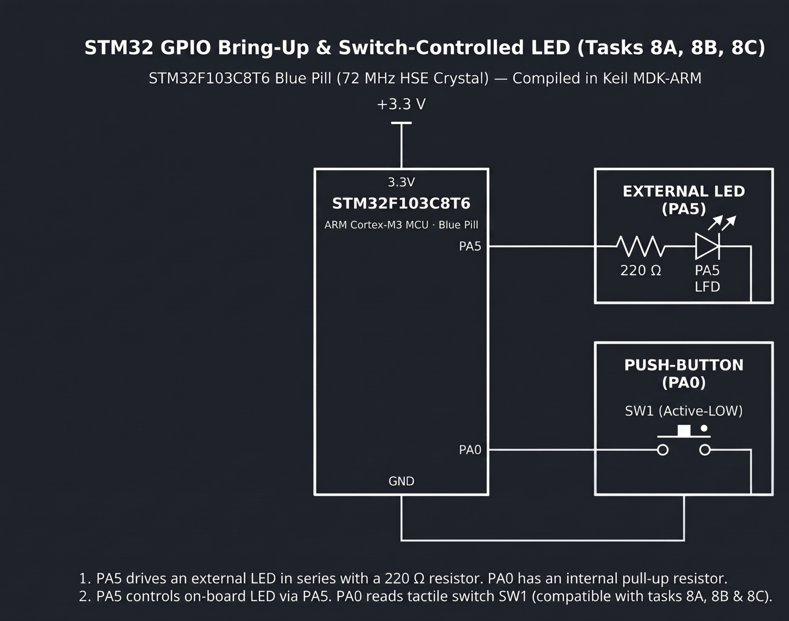

# Continuous Lab Evaluation-8 (Task 8B)

**EXP:** Continuous Lab Evaluation-8  
**DATE:** 09/10/2026  
**NAME OF EXP:** Push Button Debouncing and State Toggle on STM32  
**HARDWARE SETUP / PLATFORM:** STM32CubeMX + Keil MDK-ARM + STM32F103C8T6 (Blue Pill) + Button on PA0 + LED on PA5 + ST-Link V2  

---

### Circuit Diagram


---

### Core Logic

* **1. Two-Stage Hardware Contact Debouncing**  
  Mechanical switch bounce is filtered using a 20 ms delay, followed by secondary state verification.

* **2. Release Lock & Pin Toggling**  
  Upon confirming a valid press, `HAL_GPIO_TogglePin(GPIOA, GPIO_PIN_5)` flips the LED state. A busy-wait loop holds execution until the button is fully released:
  ```c
  if (HAL_GPIO_ReadPin(GPIOA, GPIO_PIN_0) == GPIO_PIN_RESET) {
      HAL_Delay(20);
      if (HAL_GPIO_ReadPin(GPIOA, GPIO_PIN_0) == GPIO_PIN_RESET) {
          HAL_GPIO_TogglePin(GPIOA, GPIO_PIN_5);
          while (HAL_GPIO_ReadPin(GPIOA, GPIO_PIN_0) == GPIO_PIN_RESET);
          HAL_Delay(20);
      }
  }
  ```

---

### Inference
Switch contact chatter causes erratic multiple transitions if unhandled. Implementing software debouncing and release locking ensures exactly one toggle action per physical button press.
